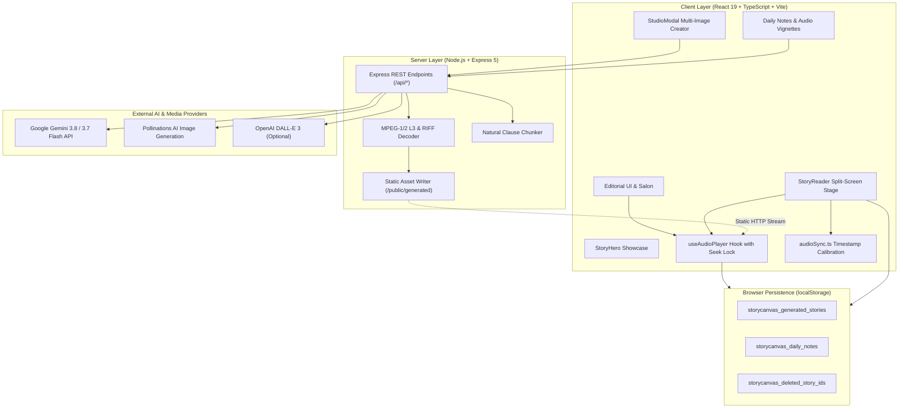
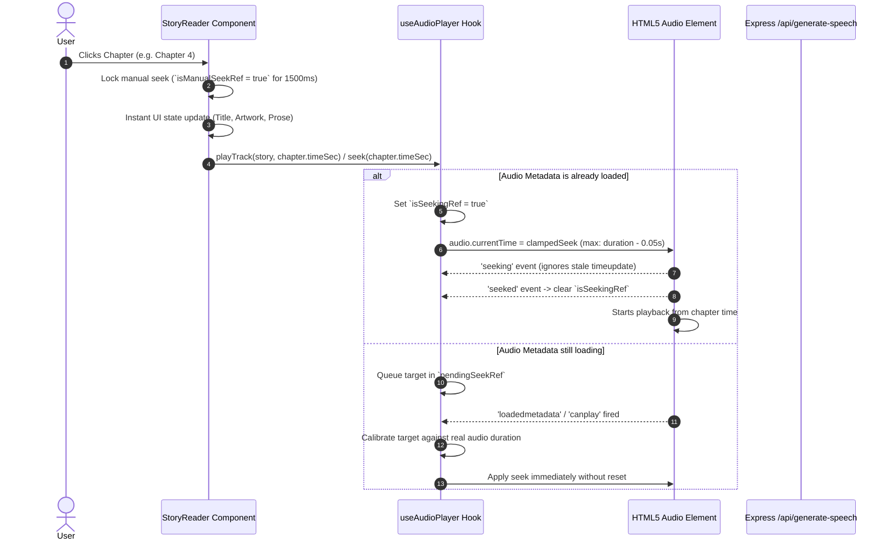
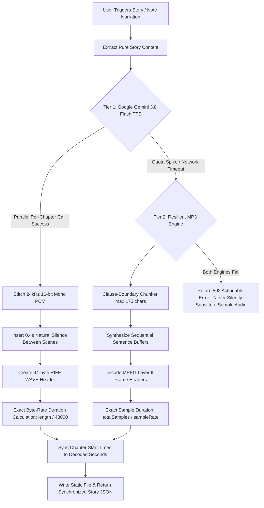

# StoryCanvas 🎨📖

> **Illustrated Literary Narratives & Synchronized Spoken Audio Engine**  
> An immersive, editorial web experience transforming visual art into multi-chapter literary chronicles with bespoke vocal performances, frame-accurate audio chapter navigation, and studio-grade media synthesis.

[](https://vitejs.dev/)
[](https://react.dev/)
[](https://www.typescriptlang.org/)
[](https://expressjs.com/)
[](LICENSE)
[](https://vercel.com/new/clone?repository-url=https://github.com/Chandru9842/storycanvas)

---

## 📑 Table of Contents

- [System Architecture](#-system-architecture)
- [Core Architecture Modules](#-core-architecture-modules)
  - [1. Audio Synchronization & Seek-Lock Engine](#1-audio-synchronization--seek-lock-engine)
  - [2. Dual-Tier Spoken Narration Pipeline](#2-dual-tier-spoken-narration-pipeline)
  - [3. Dedicated Split-Screen Reader View](#3-dedicated-split-screen-reader-view)
  - [4. Visual Story Studio](#4-visual-story-studio)
  - [5. Daily Notes & Audio Vignettes Pipeline](#5-daily-notes--audio-vignettes-pipeline)
- [Data Storage & State Management](#-data-storage--state-management)
- [Backend API Specification](#-backend-api-specification)
- [Directory Structure](#-directory-structure)
- [Getting Started](#-getting-started)
- [Deploying to Vercel](#-deploying-to-vercel)
- [Testing & Quality Assurance](#-testing--quality-assurance)
- [License & Author](#-license--author)

---

## 🏛️ System Architecture

StoryCanvas is architected as a high-performance decoupled full-stack application. The client interface is a reactive Single-Page Application (SPA) built with React 19 and Vite, styled through an editorial design system with zero CSS runtime overhead. The backend is an asynchronous Express API server providing frame-level audio stitching, text-to-speech synthesis, and multimodal AI orchestration.



---

## 🧩 Core Architecture Modules

### 1. Audio Synchronization & Seek-Lock Engine

Audio player synchronization in modern browsers is prone to race conditions caused by hardware latency, asynchronous metadata fetching, and premature `ended` events. StoryCanvas implements a deterministic audio engine in [`src/hooks/useAudioPlayer.ts`](./src/hooks/useAudioPlayer.ts) and [`src/utils/audioSync.ts`](./src/utils/audioSync.ts):



#### Key Engineering Safeguards:
- **`isSeekingRef` Hardware Guard**: Prevents intermediate pre-seek `timeupdate` events (often reporting `0.00`) from erroneously reverting the UI to Chapter 1.
- **Asynchronous Seek Queue (`pendingSeekRef`)**: Resolves race conditions when a user navigates chapters before the audio header finishes downloading over the network.
- **Safety Margin Clamping (`duration - 0.05s`)**: Prevents seeking exactly to the file end, which triggers false media `ended` events.
- **Proportional Timeline Calibration**: If a legacy or generated story's timestamps exceed the real decoded audio length, `calibrateStoryChapters()` calculates proportional intervals to ensure every chapter starts strictly inside the audio bounds.

---

### 2. Dual-Tier Spoken Narration Pipeline

Spoken narration is generated on the server through a fault-tolerant two-tier pipeline in [`server/index.mjs`](./server/index.mjs):



---

### 3. Dedicated Split-Screen Reader View

The story reader ([`src/components/StoryReader.tsx`](./src/components/StoryReader.tsx)) uses a dual-pane cinematic layout:
- **Left Stage (Artwork & Visual Atmosphere)**:
  - High-resolution cover and scene plates.
  - Active scene badge, art movement indicator, and fullscreen image zoom modal.
  - Scene dots strip providing direct navigation.
- **Right Stage (Literary Prose & Narration)**:
  - Scrubber bar with millisecond-precision track progress.
  - Full transport controls: 15s skip back/forward, variable speed cycling (`0.75x`, `1x`, `1.25x`, `1.5x`), and volume slider.
  - Classical drop-caps and customizable serif typography scale (`1rem`, `1.125rem`, `1.25rem`).
  - Distraction-free **Focus Mode** toggling fullscreen reading.

---

### 4. Visual Story Studio

The Studio modal ([`src/components/StudioModal.tsx`](./src/components/StudioModal.tsx)) provides multi-image storytelling:
- **Multi-Image Sequencing**: Upload up to 5 images to generate progressive narrative chapters.
- **Artistic Grounding**: Style prompts matching movements like *Classical Chiaroscuro Oil*, *Atmospheric Nocturne*, *Edo Woodblock*, and *Solarpunk Concept Art*.
- **Narrator Selection**: Assign distinct voice profiles (*Eleanor Vance*, *Julian Vane*, *Sachi Takahashi*, *Arthur Pendelton*).

---

### 5. Daily Notes & Audio Vignettes Pipeline

The Daily Notes module ([`src/components/AudioVignettes.tsx`](./src/components/AudioVignettes.tsx)) provides personal reflective audio journaling:
- **Three-Stage State Machine**:
  - `draft`: Text saved locally without audio (`isPlayable = false`).
  - `generating`: Active synthesis communicating with `/api/generate-speech`.
  - `ready`: Narration audio synthesized and playable with synchronized scrubbers.
  - `error`: Actionable error banner with single-click retry button.
- **Client-Side Persistence**: Notes are automatically saved in `localStorage['storycanvas_daily_notes']`.

---

## 💾 Data Storage & State Management

| Category | Storage Mechanism | Schema / Structure |
| :--- | :--- | :--- |
| **Curated Catalog** | Statically bundled in [`src/data/stories.ts`](./src/data/stories.ts) | `Story[]` array with pre-configured chapter timelines, synopsis, authors, and cover art. |
| **User Generated Stories** | Browser `window.localStorage` (`storycanvas_generated_stories`) | Full `Story` objects with generated text, artwork paths, calibrated chapter timestamps, and audio URLs. |
| **User Daily Notes** | Browser `window.localStorage` (`storycanvas_daily_notes`) | `DailyNote[]` array with status flags (`draft`, `generating`, `ready`, `error`), audio URLs, and timestamps. |
| **Archive Deletions** | Browser `window.localStorage` (`storycanvas_deleted_story_ids`) | String array of deleted story IDs, allowing users to restore default curated stories at any time. |
| **Audio Assets** | Server filesystem (`/public/generated/audio/`) | Real `.mp3` and `.wav` audio binaries accessible via static HTTP streaming. |

---

## 🔌 Backend API Specification

### `GET /api/health`
Health check and provider diagnostic endpoint.
- **Response**: `{ status: "ok", timestamp: ISOString, configured: { hasGeminiKey: boolean, imageProvider: string, ttsProvider: string } }`

### `POST /api/generate-story`
Synthesizes a 4-to-5 chapter narrative from uploaded images.
- **Payload**: `{ images: Array<{ imageBase64, mimeType, name, order }>, genre: string, artStyle: string, narrator: string }`
- **Response**: `{ success: true, story: Story }`

### `POST /api/generate-images`
Generates distinct illustrations for secondary scenes.
- **Payload**: `{ storyId: string, artStyle: string, chapters: Chapter[] }`
- **Response**: `{ success: true, chapters: Chapter[] }`

### `POST /api/generate-speech`
Synthesizes narration audio and calculates frame-accurate chapter timestamps.
- **Payload**: `{ storyId: string, title: string, chapters: Chapter[], narrator: string, isNote?: boolean }`
- **Response**:
  ```json
  {
    "success": true,
    "audioUrl": "/generated/audio/story-1792668320.mp3",
    "duration": "3 min listen",
    "durationSec": 139.44,
    "chapters": [
      { "id": "ch-1", "title": "I. The Brass Horizon", "time": "00:00", "timeSec": 0 },
      { "id": "ch-2", "title": "II. The Copper Vein", "time": "00:26", "timeSec": 26.0 }
    ]
  }
  ```

---

## 📁 Directory Structure

```
storycanvas/
├── public/
│   ├── audio/              # Curated static demonstration audio files (.mp3)
│   ├── generated/          # Runtime storage for synthesized media
│   │   ├── audio/          # Generated narration binaries (.wav / .mp3)
│   │   └── images/         # Generated scene illustrations (.jpg)
│   ├── images/             # Editorial cover plates
│   └── favicon.svg         # Application brand icon
├── server/
│   ├── config.mjs          # Environment configuration loader
│   └── index.mjs           # Express API server (TTS & Story generation)
├── src/
│   ├── components/         # Modular React Components
│   │   ├── AudioDock.tsx         # Persistent bottom audio player dock
│   │   ├── AudioVignettes.tsx    # Daily Notes & Audio Vignettes section
│   │   ├── ConfirmDeleteModal.tsx# Confirmation dialog for story deletion
│   │   ├── DailyNoteModal.tsx    # Note creation & editing modal
│   │   ├── DeleteNoteConfirmModal.tsx # Note deletion modal
│   │   ├── Footer.tsx            # Editorial footer
│   │   ├── Navbar.tsx            # Sticky navigation & search
│   │   ├── ReadNoteModal.tsx     # Note reading view
│   │   ├── StoryCard.tsx         # Curated gallery story card
│   │   ├── StoryHero.tsx         # Featured story hero showcase
│   │   ├── StoryModal.tsx        # Story overview & chapter preview modal
│   │   ├── StoryReader.tsx       # Dedicated split-screen story reader
│   │   ├── StudioModal.tsx       # Multi-image story creator studio
│   │   └── ToastNotice.tsx       # Auto-dismissing notification banner
│   ├── data/
│   │   └── stories.ts      # Curated masterwork catalog & default vignettes
│   ├── hooks/
│   │   └── useAudioPlayer.ts # Custom HTML5 audio hook with seek locking
│   ├── styles/             # Modular CSS design system tokens
│   │   ├── gallery.css
│   │   ├── hero.css
│   │   ├── modal.css
│   │   ├── navbar.css
│   │   ├── player.css
│   │   ├── reader.css
│   │   ├── studio.css
│   │   ├── tokens.css
│   │   └── vignettes.css
│   ├── utils/
│   │   └── audioSync.ts    # Chapter timestamp calibration utility
│   ├── App.tsx             # Root application orchestrator
│   ├── main.tsx            # Vite entry point
│   └── types.ts            # Core TypeScript data contracts
├── scripts/
│   └── test-story-bug.cjs  # Automated audio synchronization verification
├── .env.example            # Environment variables template
├── package.json            # Scripts & project dependencies
├── vercel.json             # Vercel SPA rewrites & build configuration
└── vite.config.ts          # Vite build & local dev proxy configuration
```

---

## 🚀 Getting Started

### Prerequisites
- **Node.js** `>= 18.0.0`
- **npm** or **pnpm**
- A **Google Gemini API Key** (obtain free from [Google AI Studio](https://aistudio.google.com/app/apikey))

### 1. Clone the Repository
```bash
git clone https://github.com/Chandru9842/storycanvas.git
cd storycanvas
```

### 2. Install Dependencies
```bash
npm install
```

### 3. Configure Environment Variables
Create your local `.env` file based on [`.env.example`](./.env.example):
```bash
cp .env.example .env
```
Add your credentials:
```ini
PORT=3001
GEMINI_API_KEY=AQ.your_complete_gemini_api_key_here
IMAGE_PROVIDER=pollinations
TTS_PROVIDER=gemini_tts
```

> [!NOTE]  
> If your Google Gemini key starts with `AQ.`, make sure to include the entire string as issued by Google AI Studio.

### 4. Run the Application
Start the backend Express server:
```bash
npm run server
```
In a separate terminal, start the frontend development server:
```bash
npm run dev
```
Open **[http://localhost:5173](http://localhost:5173)** in your browser.

---

## 🌐 Deploying to Vercel

StoryCanvas includes a tailored [`vercel.json`](./vercel.json) that configures Vite Single-Page Application routing (`rewrites` to `/index.html`):

1. Push your repository to your GitHub account:
   ```bash
   git push origin main
   ```
2. Sign in to **[Vercel](https://vercel.com/)** and click **Add New... ➔ Project**.
3. Import your **`Chandru9842/storycanvas`** repository.
4. Verify the detected settings:
   - **Framework Preset**: `Vite`
   - **Build Command**: `npm run build`
   - **Output Directory**: `dist`
5. Under **Environment Variables**, add:
   - `GEMINI_API_KEY`: Your full Gemini API key.
   - `IMAGE_PROVIDER`: `pollinations`
   - `TTS_PROVIDER`: `gemini_tts`
6. Click **Deploy**.

---

## 🧪 Testing & Quality Assurance

StoryCanvas includes an automated test suite verifying audio duration calculation, timestamp calibration, and chapter selection:

```bash
# Run the automated 5-scene chapter synchronization verification
node ./scripts/test-story-bug.cjs

# Verify TypeScript types and production bundle compilation
npm run build
```

---

## 📜 License

Distributed under the **MIT License**. See `LICENSE` for details.

---

## 👤 Author

**Chandru M**  
- GitHub: [@Chandru9842](https://github.com/Chandru9842)
